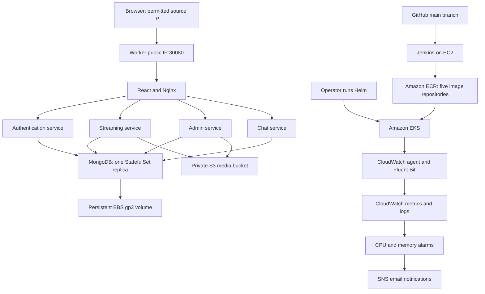

# StreamingApp Architecture

## Overview

StreamingApp runs on Amazon EKS in ap-south-1 using Kubernetes 1.35.
A Helm chart deploys the React frontend, four Node.js backend services,
and MongoDB. The application images are stored in private Amazon ECR
repositories.

## Architecture diagram

## Application components

| Component | Internal port | Baseline replicas | Purpose |
|---|---:|---:|---|
| Frontend | 80 | 2 | React website and Nginx reverse proxy |
| Auth | 3001 | 2 | Registration, login and JWT issuance |
| Streaming | 3002 | 2 | Catalogue, thumbnails and video playback |
| Admin | 3003 | 1 | Video upload and catalogue administration |
| Chat | 3004 | 1 | Socket.IO chat and stored message history |
| MongoDB | 27017 | 1 | Persistent application data |

The frontend Service exposes port 30080 using NodePort.
Backend Services and MongoDB are internal to the cluster.

## Request routing

| Browser path | Destination |
|---|---|
| `/auth/api/` | Auth service `/api/` |
| `/streaming/` | Streaming service `/` |
| `/admin/api/` | Admin service `/api/` |
| `/chat/api/` | Chat service `/api/` |
| `/socket.io/` | Chat WebSocket endpoint |
| Other frontend paths | React application |

Nginx supports React page refreshes, WebSocket upgrades, and upload
requests up to 100 MB. Test uploads used small media files.

## Build and deployment workflow

1. A developer pushes to GitHub main.
2. Jenkins polls Git approximately every five minutes.
3. Jenkins builds all five images.
4. Its EC2 IAM role permits pushing images to the project ECR repositories.
5. Images receive a tag such as build-5.
6. An operator selects the image tag in Helm values and runs helm upgrade.

Image builds and pushes are automatic. EKS deployments are currently
performed manually with Helm. The validated application image tag is build-5.

## Storage and AWS permissions

MongoDB stores data on a 5 GiB encrypted EBS gp3 volume.
Its PVC survives pod replacement. Deleting the PVC deletes the disk
under the configured reclaim policy.

Media is stored in a private S3 bucket with Block Public Access enabled.
The admin service can read, upload and delete media in the videos and
thumbnails prefixes. Streaming has read access only.

Separate IAM roles for Kubernetes service accounts provide S3 access.
The application does not require static AWS access keys in its pods.
MongoDB credentials and the JWT signing key are held in an existing
Kubernetes Secret outside the Helm chart and Git repository.

## Scaling

Auth and streaming each use a Horizontal Pod Autoscaler:
- Minimum: 2 replicas.
- Maximum: 4 replicas.
- CPU target: 60% of requested CPU.
- Scale-down stabilization window: 120 seconds.

A temporary CPU workload demonstrated auth scaling from 2 to 4 replicas,
then returning to 2. This was a scaling demonstration, not a traffic benchmark.

The worker group has two nodes and a configured maximum of three.
No automatic worker-node scaling controller is installed.
Chat remains at one replica because multiple replicas require a shared
Socket.IO adapter.

## Monitoring and notifications

CloudWatch Observability collects container logs and infrastructure metrics.
Container Insights provides cluster-level node CPU and memory measurements.

Two alarms monitor average node CPU and memory utilization above 80%
for two consecutive one-minute periods. ALARM and OK transitions are
connected to an SNS email topic. Email delivery was tested.

Container Insights log groups use seven-day retention.
EKS control-plane logging is also enabled.

## Validation completed

- Local Docker builds, registration and login.
- Automatic Jenkins build after a GitHub commit.
- EKS application deployment through Helm.
- Public NodePort access, login and page refresh.
- Admin uploads to private S3.
- Thumbnail display, video playback, seeking and HTTP 206 responses.
- Chat exchange between separate browser sessions and persisted history.
- MongoDB data persistence after pod replacement.
- HPA scale-up and scale-down.
- CloudWatch application log delivery and SNS email delivery.

## Lab constraints and limitations

AWS rejected load balancer creation with:
"This AWS account currently does not support creating load balancers."

The frontend therefore uses NodePort, restricted by a security-group rule
to the operator's public IP. An AWS load balancer requires removal of
the account restriction. Worker public IPs can change after replacement.

The lab endpoint uses HTTP. MongoDB is a single instance, not a replica
set, and the application uses its administrator account for database access.
Production would require TLS, database least privilege, backup and
availability planning, and dependency remediation.

The initial frontend build reported dependency vulnerabilities.
These have not been claimed as resolved.
